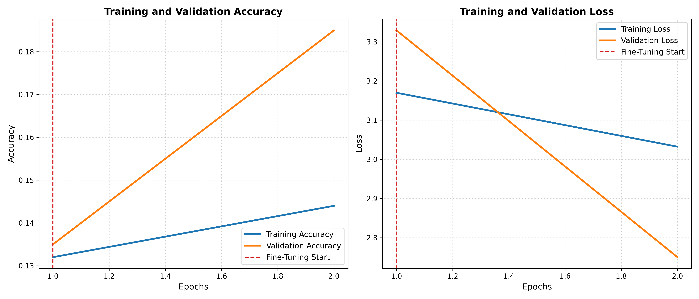
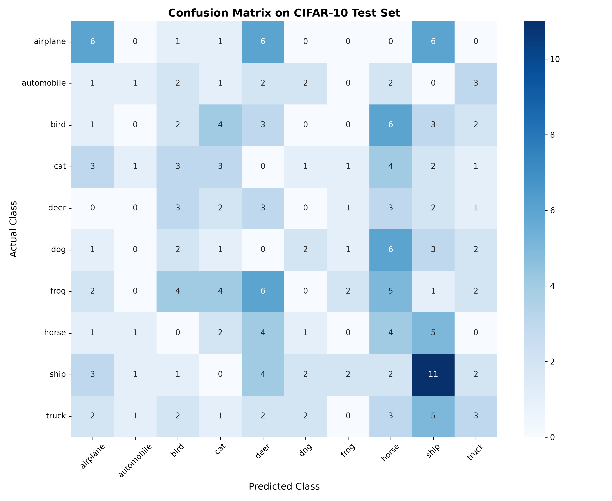
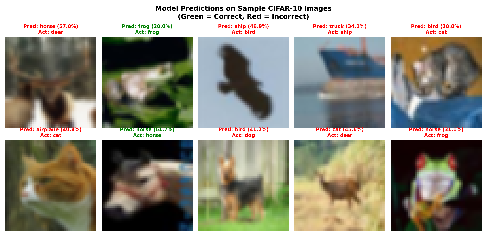
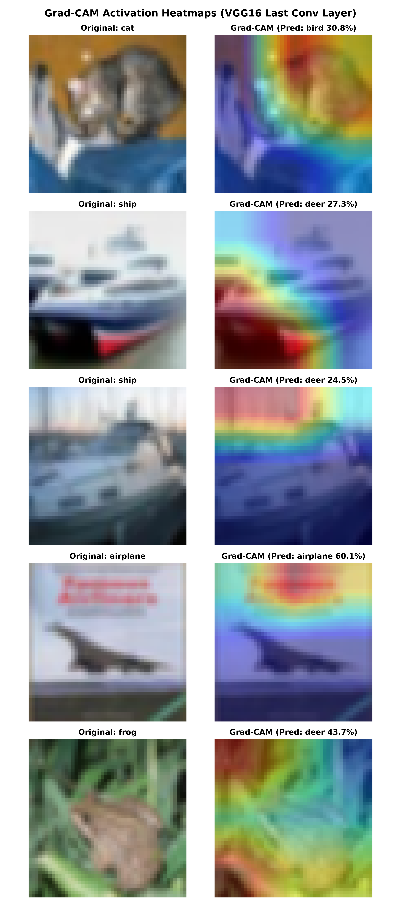

<div align="center">

# 🧠 Explainable Deep Learning: CIFAR-10 Classification with VGG16 & Grad-CAM

[](https://www.python.org/)
[](https://tensorflow.org/)
[](https://streamlit.io/)
[](https://opensource.org/licenses/MIT)

An end-to-end Computer Vision system implementing **Transfer Learning with VGG16**, **Grad-CAM visual explainability**, and an interactive **Streamlit dashboard** for real-time inference on the CIFAR-10 dataset.

</div>

---

## 📌 Highlights

- **Transfer Learning Backbone:** Pretrained VGG16 on ImageNet, fine-tuned on CIFAR-10 classes.
- **Explainable AI (XAI):** Gradient-weighted Class Activation Mapping (Grad-CAM) to visualize exactly which regions the network attends to before making a prediction.
- **Interactive UI:** Streamlit web application supporting image uploads, instant probability distributions, and dynamic heatmap overlays.
- **Data Augmentation & Regularization:** Built-in rotation, width/height shifts, zoom, and dropout layers to prevent overfitting.

---

## 📊 Model Evaluation & Visualizations

| Training & Validation Curves | Confusion Matrix |
| :---: | :---: |
|  |  |

| Model Predictions & Confidence | Grad-CAM Explainability |
| :---: | :---: |
|  |  |

---

## 🚀 Quickstart

### 1. Clone & Setup Environment
```bash
git clone https://github.com/jannu15006-ship-it/CIFAR10-VGG16-Explainable-AI.git
cd CIFAR10-VGG16-Explainable-AI

# Create virtual environment
python -m venv venv
source venv/bin/activate   # On Windows: .\venv\Scripts\activate

# Install dependencies
pip install -r requirements.txt
```

### 2. Train the Model
```bash
python cifar10_model.py
```
*(Tip: Set `FAST_DRY_RUN=True` for a quick 2-epoch test run)*

### 3. Launch the Streamlit App
```bash
streamlit run app.py
```

---

## 🏗️ Project Architecture

```
├── app.py                  # Interactive Streamlit application
├── cifar10_model.py        # Model definition, training pipeline & Grad-CAM generation
├── requirements.txt        # Python package dependencies
├── .gitignore              # Ignores __pycache__ and heavy .h5 model binaries
├── confusion_matrix.png    # Evaluation confusion matrix
├── gradcam_results.png     # Visual Grad-CAM heatmap results
├── predictions.png         # Model sample predictions
└── training_results.png    # Accuracy & Loss curves across epochs
```

---

## 👩‍💻 Author
**Jahnavi Lalitha**
- GitHub: [@jannu15006-ship-it](https://github.com/jannu15006-ship-it)
- Email: [jannu15006@gmail.com](mailto:jannu15006@gmail.com)
